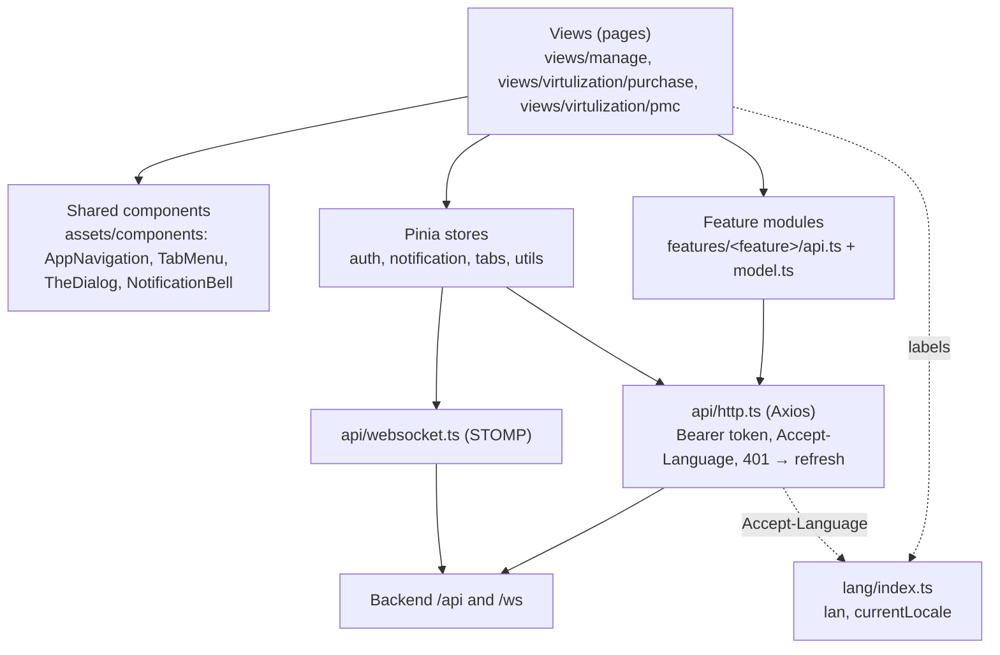
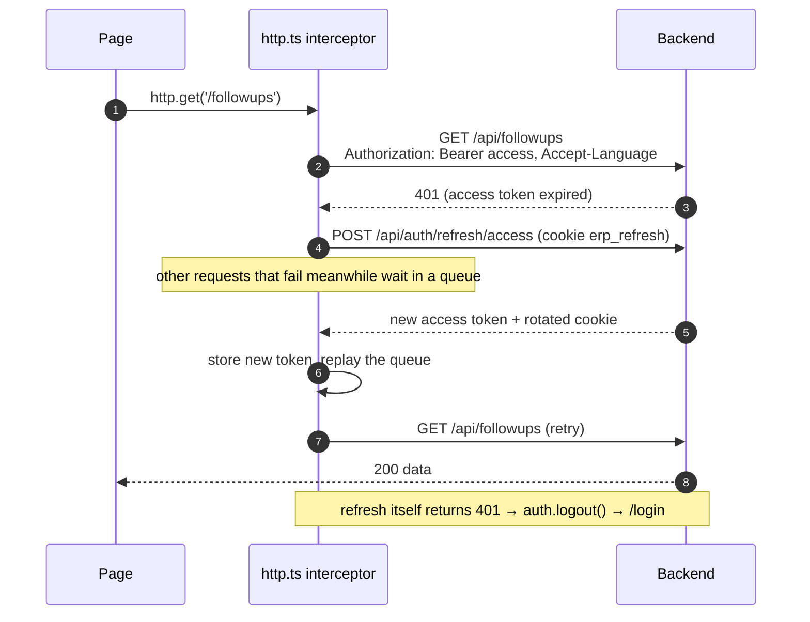
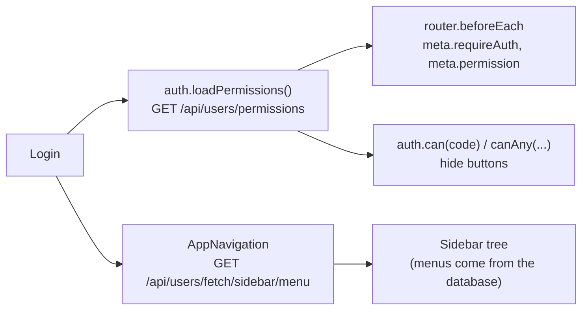
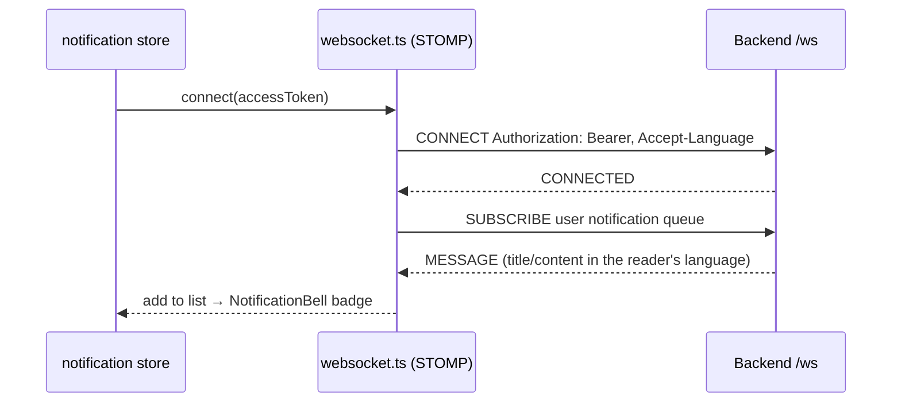
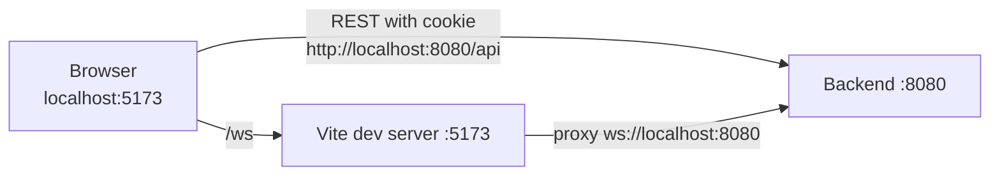
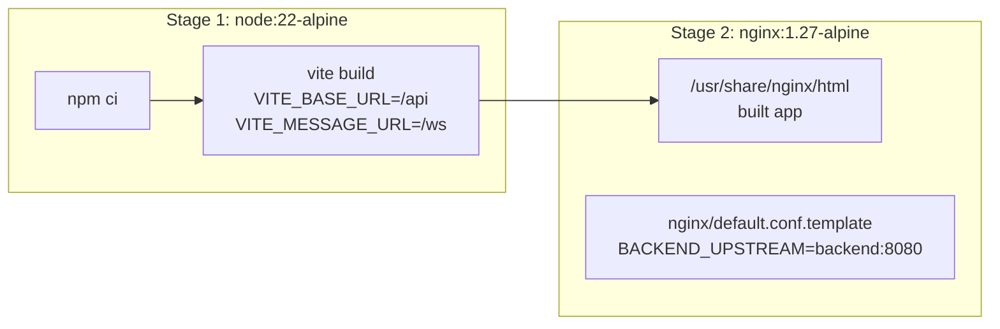

# Generic ERP Frontend — Development Guide

> **Last updated:** 2026-11-28 · **Branch model:** feature branch → PR → `main`

This guide is for developers who change the frontend. It explains how the app is organized, how
login, permissions, localization and live notifications work, how to run it on your machine, and
the rules every change follows. For a short overview see [README.md](README.md).

## Table of contents

1. [Architecture](#1-architecture)
2. [Authentication and session refresh](#2-authentication-and-session-refresh)
3. [Permissions, routes and the sidebar](#3-permissions-routes-and-the-sidebar)
4. [Localization](#4-localization)
5. [Live notifications (WebSocket)](#5-live-notifications-websocket)
6. [Local development](#6-local-development)
7. [Environment variables](#7-environment-variables)
8. [Testing and code quality](#8-testing-and-code-quality)
9. [Docker image and deployment](#9-docker-image-and-deployment)
10. [Conventions and adding a page](#10-conventions-and-adding-a-page)
11. [Module status](#11-module-status)

---

## 1. Architecture

### 1.1 Layers



- **Views** are pages. They hold page state and layout only.
- **Feature modules** (`src/features/<feature>/`) hold everything a feature needs that is not UI:
  `api.ts` (typed backend calls), `model.ts` (types, pure helper functions, status rules) and
  `__tests__/`. Keeping logic here makes it testable without mounting components.
- **Stores** hold app-wide state: the signed-in user and permissions (`auth`), notifications
  (`notification`), open tabs (`tabs`), global dialogs (`utils`).
- **`api/http.ts`** is the only Axios instance. Never create another one.

### 1.2 Folder map

```
app/src/
├── main.ts / App.vue        bootstrap: Pinia, Vuetify, router
├── api/                     http.ts, websocket.ts, notification.ts
├── features/                customer-order, dashboard, followup-plan-group, followup-template,
│                            order-audit, permissions, placement-task, purchase-exception,
│                            purchase-followup, quotation
├── views/
│   ├── auth/LoginView.vue
│   ├── home/                Dashboard.vue, RootDashboard.vue
│   ├── manage/              UserManage, DepartmentManage, PermissionAllocation, PermissionManage,
│   │                        ProductManage (empty), view/ (sub-pages), components/
│   ├── virtulization/       DashboardView, purchase/*, pmc/* (folder name kept for history)
│   ├── MainEntry.vue        layout: sidebar + tab bar + router view
│   └── NotFound.vue
├── router/                  index.ts (guard), file/manage.ts, file/virtualization.ts
├── stores/                  auth.ts, notification.ts, tabs.ts, utils.ts
├── lang/                    index.ts, china_zh.ts, us_en.ts, __tests__/ (key parity)
├── assets/                  components/, config/, styles/
├── theme/  types/  utils/  plugins/  definition/
└── __tests__/
```

## 2. Authentication and session refresh

The access token lives in the `auth` store (and `localStorage` key `auth-session`, so a reload
keeps you signed in). The refresh token is **never** visible to JavaScript: the backend keeps it in
the HttpOnly cookie `erp_refresh` (path `/api/auth`). Axios sends it because the instance uses
`withCredentials: true`.



Rules in `http.ts`:

- **401** → refresh once, then retry. Only one refresh runs at a time; parallel 401s are queued.
- **401 from the refresh call** → the session is over: log out and go to `/login`.
- **403** → no refresh (the token is fine). Show the "no permission" dialog and reload the
  user's permissions so the UI hides what they lost.
- Anything else (500, 404, network error) passes through untouched.

## 3. Permissions, routes and the sidebar

Permissions are **string codes** such as `menu.customerOrder.read` or
`menu.order-audit-task.read`, not numbers. After login the store loads them from
`GET /api/users/permissions`.



- **Route guard** (`router/index.ts`): a route with `meta.requireAuth: true` needs a signed-in
  user; a route with `meta.permission: ['code', ...]` needs **any one** of the codes.
- **Buttons**: use `auth.can('code')` to hide actions. This is only a hint; the backend checks
  every request with the same code.
- **Sidebar**: the menu tree comes from the backend (`menu` table). A menu's route must match a
  path in the Vue router. A parent only shows its children when the parent's route is empty.
  To hide a menu, delete its row (the sidebar does not read `is_enabled`).

## 4. Localization

**Rule for every change:** every label is localized, and the backend answers in the page's
language.

- `src/lang/index.ts` is the **only** place to import from. It exports `lan` (the labels of the
  current language), `currentLocale` (`zh-CN` or `en-US`), `fmt('{0} items', n)` and
  `setLocale(...)`.
- Never import `china_zh.ts` or `us_en.ts` directly. Add every new key to **both** files; a
  test in `src/lang/__tests__/` fails when the key sets differ.
- The choice is saved in `localStorage` (`erp.locale`, default `zh-CN`). Changing the language
  reloads the page, so stores and the WebSocket reconnect with the new language.
- `http.ts` sends `Accept-Language: <currentLocale>` on every request and `websocket.ts` sends it
  on the STOMP CONNECT frame. That is how backend error messages and pushed notifications come
  back in the same language.

## 5. Live notifications (WebSocket)



- The broker URL comes from `VITE_MESSAGE_URL`. A value that starts with `/` (the normal case) is
  turned into `ws://<current host>/ws` or `wss://...` on HTTPS, so it always uses the page's own
  host. In development the Vite dev server proxies `/ws` to `ws://localhost:8080`.
- The client reconnects every 5 s and uses 10 s heartbeats. Subscriptions requested before the
  connection is ready are replayed after CONNECTED.
- Stored notifications (history, read state) come from `/api/notifications`.

## 6. Local development

### 6.1 Prerequisites

| Tool | Version |
|---|---|
| Node.js | `^20.19.0` or `>=22.12.0` (the Docker build uses 22) |
| npm | bundled with Node |
| Backend | running on `http://localhost:8080` with MySQL and Redis (backend `DEVELOPMENT.md`, section 5) |
| Editor | VS Code + Vue (Official) extension, recommended in `app/.vscode` |

### 6.2 Run

```bash
cd app
npm install
cat > .env.local <<'EOF'
VITE_BASE_URL=http://localhost:8080/api
VITE_MESSAGE_URL=/ws
EOF
npm run dev                    # http://localhost:5173
```



Why this works: `localhost:5173` and `localhost:8080` count as the **same site** for cookies, so
the `SameSite=Strict` refresh cookie is still sent. The backend must allow the dev origin
(`CORS_ALLOWED_ORIGINS=http://localhost:5173,...`, which is its default) and run with
`AUTH_COOKIE_SECURE=false` on plain HTTP.

Log in as **root / ChangeMe@2026** (created by the backend's database init script).

### 6.3 Troubleshooting

| Symptom | Cause and fix |
|---|---|
| Every request goes to `http://localhost:5173/auth/...` and fails | `VITE_BASE_URL` is missing. It must end with `/api`. Restart `npm run dev` after editing `.env.local`. |
| Login works, but after 15 minutes you are logged out | The refresh cookie was not stored: check `AUTH_COOKIE_SECURE=false` on the backend for HTTP, and that you use `localhost` for both, not `localhost` + `127.0.0.1`. |
| CORS error in the console | Add your origin to the backend's `CORS_ALLOWED_ORIGINS`. |
| Messages from the backend are in the wrong language | The backend bundle lacks the key, or the request did not go through `api/http.ts`. |
| Notification bell never updates | The backend is not on `localhost:8080` (change the `/ws` proxy target in `vite.config.ts`), or the STOMP CONNECT was rejected (expired token). Set `VITE_APP_DEV_MODE=true` to log STOMP frames. |

## 7. Environment variables

Vite only exposes variables that start with `VITE_`. They are read at **build time**.

| Variable | Development value | Docker image value | Meaning |
|---|---|---|---|
| `VITE_BASE_URL` | `http://localhost:8080/api` | `/api` | Base URL of the REST API, including `/api` |
| `VITE_MESSAGE_URL` | `/ws` | `/ws` | STOMP endpoint; a path is resolved against the page's host |
| `VITE_APP_DEV_MODE` | unset, or `true` to debug | `false` | When set, STOMP frames are logged to the console. Note: any non-empty value turns it on. |

## 8. Testing and code quality

```bash
cd app
npx vitest run                                   # all tests once (160 tests in 34 files, ~10 s)
npx vitest run src/features/quotation            # one folder
npm run test:unit                                # watch mode
npm run type-check                               # vue-tsc
npm run lint                                     # oxlint, then eslint (both auto-fix)
npm run format                                   # prettier
```

- Tests live next to the code in `__tests__/` folders and run in jsdom.
- Put business rules in `features/<feature>/model.ts` and test them there.
- Run `npm run type-check` and `npx vitest run` before every PR.

| Style rule | Value |
|---|---|
| Semicolons | none |
| Quotes | single |
| Line width | 100 |
| Indent | 2 spaces |
| Imports | always via the `@/` alias (`@/` = `app/src/`) |
| TypeScript | `strict` + `noUncheckedIndexedAccess` (index access returns `T \| undefined`) |

## 9. Docker image and deployment

The image is built from `app/Dockerfile` and is normally started by the Docker Compose stack in
the backend repository (`generic_erp/deploy`, service `generic-erp-frontend`).



What `nginx/default.conf.template` does:

- `/api/` and `/ws` are proxied to `${BACKEND_UPSTREAM}` with the `X-Forwarded-*` headers;
  `/ws` gets the WebSocket upgrade headers and a 1 h read timeout.
- Uploads up to 30 MB (`client_max_body_size`); the backend accepts 25 MB per request.
- `/assets/` (hashed files) are cached for 30 days; `index.html` is `no-cache`, so a new release
  shows up on the next reload.
- Everything else falls back to `index.html` (the app uses hash routing).

Deploy steps (from the backend repo): `cd generic_erp/deploy && docker compose up -d --build`.
The frontend source is taken from `FRONTEND_DIR` (default `../../generic-front/app`), so clone
both repositories next to each other. The site is published on `ERP_HTTP_PORT` (default 8088).

## 10. Conventions and adding a page

### Conventions

- Composition API with `<script setup lang="ts">`; Pinia stores in `setup` style.
- Backend calls only through `@/api/http`, typed, inside `features/<feature>/api.ts`.
- No hard-coded user-visible text: every label goes through `lan` from `@/lang`.
- Show dates and numbers with the current locale.
- Hide actions the user may not do with `auth.can(...)`, but never rely on it for security.

### Checklist for a new page

1. **Feature module**: `src/features/<feature>/api.ts` and `model.ts`, plus tests.
2. **View**: `src/views/virtulization/<area>/<Page>.vue` (or `views/manage/` for admin pages).
3. **Route**: add it to `router/file/virtualization.ts` (or `manage.ts`) with
   `meta: { title, icon, requireAuth: true, permission: ['menu.<page>.read'] }`. `title` is a
   `lan` key.
4. **Labels**: add every key to both `lang/china_zh.ts` and `lang/us_en.ts`.
5. **Backend side**: the permission code and the sidebar menu row (route = the path from step 3)
   are created by a backend SQL migration; the backend's message keys go in both bundles.
6. Run `npm run type-check`, `npx vitest run` and `npm run lint`.

## 11. Module status

| Module | Status |
|---|---|
| Login, session refresh via HttpOnly cookie, logout | Done |
| Permission-code route guard, backend-driven sidebar, multi-tab workspace | Done |
| zh-CN / en-US localization with language switch | Done |
| Light/dark theme | Done |
| Notifications (bell + live STOMP push) | Done |
| Users, departments, permission allocation, permission management | Done |
| Purchase dashboard, follow-up to-do, templates, plan groups | Done |
| Placement tasks | Done |
| Quotation list and quotation plan (报价方案) | Done; rules still being refined with purchasing |
| Purchasing exceptions with PMC approval | Done |
| PMC dashboard, customer order review, order audit tasks, evidence | Done |
| Docker image (nginx, same-origin proxy) | Done |
| Product management page | Not started (`ProductManage.vue` is empty; backend API exists) |
| BOM, demand review, warehouse | Not started |
