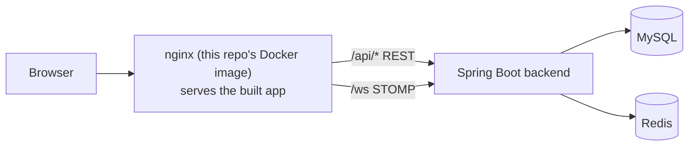

# Generic ERP — Frontend

The Vue 3 web client of the **Generic ERP** system. It talks to the Spring Boot backend
([generic_erp](https://github.com/GenesisYoung/generic_erp)) over a JSON REST API (`/api`) and a
STOMP WebSocket (`/ws`). The whole UI is available in **Simplified Chinese** (default) and
**English**, and the backend answers in the same language as the page.

> **Where to go next**
> - Develop locally, architecture, conventions: [DEVELOPMENT.md](DEVELOPMENT.md)
> - Deploy the whole system (frontend + backend + MySQL + Redis): [generic_erp/deploy/README.md](https://github.com/GenesisYoung/generic_erp/blob/main/deploy/README.md)
> - Feature notes: [`app/docs/`](app/docs)

## What the user can do

| Area | Pages |
|---|---|
| Sign-in | Login, automatic session refresh, logout, language switch, light/dark theme |
| Workspace | Permission-driven sidebar, multi-tab workspace, notification bell with live push |
| Purchasing | Purchase dashboard, follow-up to-do list, follow-up templates, follow-up plan groups, placement tasks, quotation list and quotation plan (报价方案), purchasing exceptions |
| PMC | PMC dashboard, customer order review, order audit tasks, evidence management |
| Administration | Users, departments, permission allocation (per user, per permission, department defaults), permission management (actions, permissions, menus) |

What each user sees depends on the permission codes of their department role (plus per-user
page overrides). The backend checks every request again.

## How it fits together



In production the page, `/api` and `/ws` share **one origin**, so there is no CORS and the
HttpOnly refresh cookie (path `/api/auth`) is always sent.

## Tech stack

| Layer | Technology |
|---|---|
| Framework | Vue 3.5 (Composition API, `<script setup>`) |
| Language | TypeScript 5.9 (strict, `noUncheckedIndexedAccess`) |
| Build | Vite 8 |
| UI | Vuetify 4 + Material Design Icons |
| State | Pinia 3 |
| Routing | Vue Router 5 (hash history) |
| HTTP | Axios with token-refresh interceptor |
| Realtime | `@stomp/stompjs` 7 over native WebSocket |
| Charts | Apache ECharts 6 via vue-echarts |
| Testing | Vitest 4 + @vue/test-utils (jsdom) |
| Linting | Oxlint + ESLint + Prettier |
| Serving | nginx 1.27 (Docker image) |

## Quick start (development)

**You need:** Node.js `^20.19.0` or `>=22.12.0`, and the backend running on
`http://localhost:8080` (see the backend's `DEVELOPMENT.md`).

```bash
cd app
npm install
# app/.env.local (git-ignored)
printf 'VITE_BASE_URL=http://localhost:8080/api\nVITE_MESSAGE_URL=/ws\n' > .env.local
npm run dev            # http://localhost:5173
```

Log in as **root / ChangeMe@2026** (the account created by the backend's database init script).

### Common commands (run in `app/`)

| Command | What it does |
|---|---|
| `npm run dev` | Vite dev server on port 5173, proxies `/ws` to the backend |
| `npm run build` | Type-check and build to `app/dist/` |
| `npm run type-check` | `vue-tsc` only |
| `npx vitest run` | All unit tests once (`npm run test:unit` starts watch mode) |
| `npm run lint` | Oxlint then ESLint, both auto-fix |
| `npm run format` | Prettier over `src/` |

## Project layout

```
generic-front/
├── app/                      the application (all commands run here)
│   ├── src/
│   │   ├── api/              Axios instance (http.ts), STOMP client (websocket.ts), notifications
│   │   ├── features/         one folder per business feature: api.ts + model.ts + tests
│   │   ├── views/            pages: auth, home, manage (admin), virtulization (purchase, pmc)
│   │   ├── router/           routes with meta.permission; file/manage.ts, file/virtualization.ts
│   │   ├── stores/           Pinia: auth, notification, tabs, utils
│   │   ├── lang/             index.ts (the only entry), china_zh.ts, us_en.ts
│   │   ├── assets/           shared components (navigation, tabs, dialogs, notification bell)
│   │   └── theme/  types/  utils/
│   ├── nginx/                nginx config template for the Docker image
│   ├── Dockerfile            build with Node 22, serve with nginx
│   └── docs/                 feature notes (order audit)
├── README.md
└── DEVELOPMENT.md
```

## License and ownership

Designed and developed by Genesis Young. Private project.
